## Summary

We detect 8 object classes (pedestrian and people merged into `person`, awning-tricycle merged into `tricycle`, plus bicycle, car, van, truck, bus, motor) in drone video frames. The data are 63 labelled VisDrone-VID clips (27,047 frames, 1.22 M boxes) and a hidden test set of 48 clips (3,811 frames). The metric is COCO mAP@[.5:.95].

Our best single model is **RT-DETR-l at 1536 px trained on all 63 clips** (public leaderboard 0.3465). Our final submission is a weighted-box-fusion ensemble of ten RT-DETR models trained on different frames or sets of clips, followed by temporal rescoring along each clip, and it scores **0.3724** on the public leaderboard (first place at the time of writing, 0.0009 ahead of the second team, which is inside the noise of the public part of the test set). Model comparisons were first made on one clip-level validation fold and then repeated with five-fold cross-validation; differences smaller than about 0.02 mAP should not be read as real (see [Noise](#how-much-to-trust-the-numbers)). Several things that looked good on validation did not help on the leaderboard, and we report these as they are.

## 1. Data and validation protocol

**Conversion.** VisDrone `ignored region` and `others` become don't-care regions. In training they are filled with gray, except where they overlap a valid box. In evaluation they are crowd regions (`iscrowd=1`), so detections inside them are neither rewarded nor penalised. Our evaluator is COCO-style with `maxDets=[1, 100, 500]`, matching the 500-detections-per-image limit of the submission.

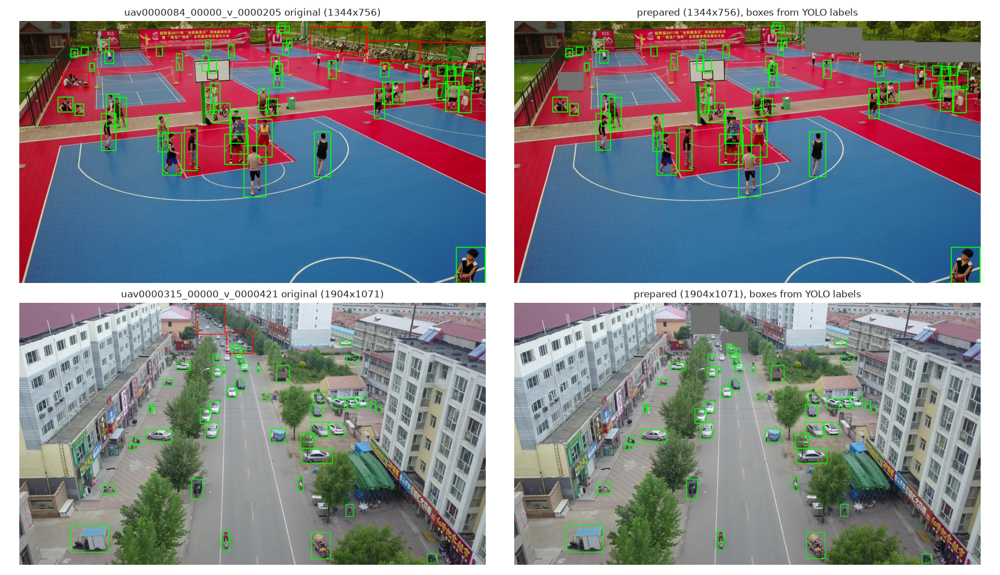

**What the EDA showed** (figures below):

- Objects are tiny: the median box is about 32 px at the 1344 px model input and 50% of boxes are COCO-small. Scenes are dense (median 42 objects per frame, up to 180).
- Classes are imbalanced: car 44%, person 31%, motor 9%, bus only 0.8%.
- Consecutive frames are nearly identical: the same object has a median IoU of 0.89 with itself one frame later, 0.59 after five frames and 0.09 after twenty. We therefore train on every 10th frame, since adding more neighbouring frames adds almost no information (confirmed in §4).
- The default torchvision anchors (32-512) reach IoU ≥ 0.5 with only 75% of the boxes. Anchors 16-256 reach 98%, and 12-192 reach 99% (k-means on the box sizes gives 14 to 95 px).
- **Test clips differ from the labelled ones.** The test set contains low-resolution clips (680x382, 960x540) that do not exist among the labelled clips, while some labelled clips are 2.7K-4K, and test clips are much shorter (35-148 frames).

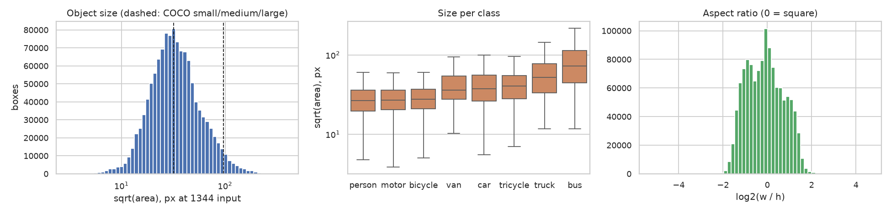
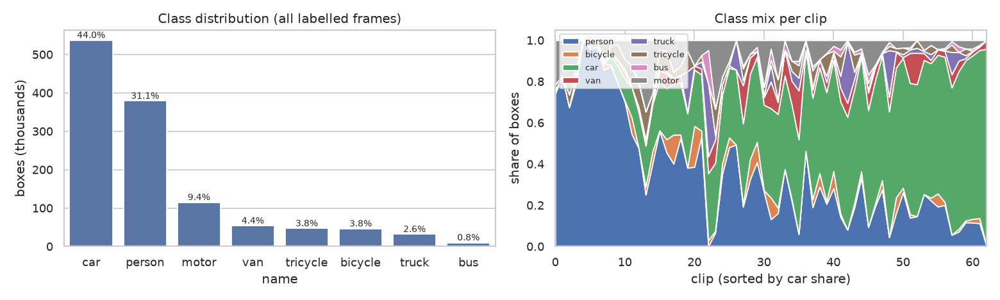
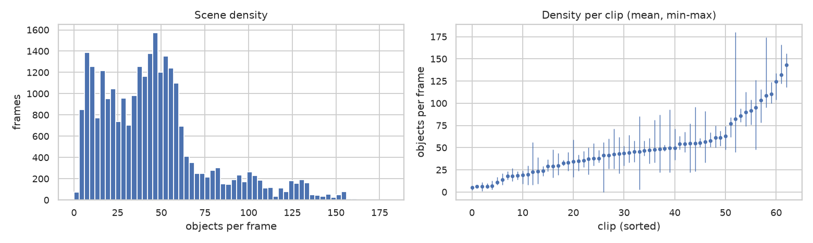

**Split.** Frames of one clip must not appear on both sides, because neighbouring frames are near-duplicates. We use 5-fold `GroupKFold` by clip and, because of the compute budget (Kaggle T4, 30 GPU-hours per week), validate every model on **fold 0 only** (1,354 validation frames, one frame in four of the held-out clips). Training uses 2,189 frames (every 10th frame of the other folds) unless stated otherwise. Every detector is trained for 12 epochs (one later run with 24 epochs is in §4). Fold assignments are stored in `src/hw2/configs/folds.csv`, because `GroupKFold` returns different folds in different scikit-learn versions.

Models trained on all 63 clips have no clean validation set. Their "fold 0" numbers (about 0.54) are in-sample and are not used in any comparison below.

## 2. Detectors and tuning experiments

Every family has a baseline and at least two modified runs. "fps" is the throughput logged by our validation script on a Kaggle T4 and is only meant for comparing the models with each other.

| Family | Run | What changed | mAP | AP50 | AP_small | fps |
|---|---|---|---|---|---|---|
| Faster R-CNN (R50-FPN v2) | frcnn_base | torchvision defaults | 0.2595 | 0.4813 | 0.0811 | 14.4 |
| | frcnn_a16 | anchors 16-256 | 0.2736 | 0.5149 | 0.0802 | 14.4 |
| | frcnn_giou | GIoU RoI box loss, 2000 test proposals | 0.2608 | 0.4849 | 0.0778 | 10.9 |
| RetinaNet (anchor-based) | retina_base | defaults | 0.2287 | 0.4175 | 0.0454 | 18.6 |
| | retina_a12 | anchors 12-192 | 0.1834 | 0.3992 | 0.0664 | 19.2 |
| YOLO11s (anchor-free) | yolo_base | 1344 px | 0.2449 | 0.4427 | 0.0797 | 74.9 |
| | yolo_base_s1 | same, other seed | 0.2294 | 0.4123 | 0.0769 | 71.3 |
| | yolo_base_r2 | same as `yolo_base`, repeated (noise check) | 0.2514 | 0.4551 | 0.0787 | 74.7 |
| | yolo_nwd | box loss 0.5·CIoU + 0.5·NWD | 0.2489 | 0.4496 | 0.0739 | 76.3 |
| | yolo_1920 | input 1920 px | 0.2511 | 0.4517 | 0.0837 | 37.3 |
| RT-DETR-l (query-based) | rtdetr_base | 300 queries, 1344 px | 0.2971 | 0.5424 | 0.1085 | 10.0 |
| | rtdetr_q500 | 500 queries / 200 denoising queries | 0.2973 | 0.5414 | 0.0970 | 12.2 |
| | rtdetr_cost | Hungarian cost class 2, L1 5, GIoU 5, no-object 0.1 | 0.3004 | 0.5436 | 0.1059 | 12.1 |
| | rtdetr_s5 | same as `rtdetr_cost`, other frame subsample (noise check) | 0.2945 | 0.5291 | 0.0973 | 12.6 |
| | rtdetr_s5_1536 | input 1536 px | **0.3096** | 0.5510 | 0.1024 | 10.2 |
| | rtdetr_x | RT-DETR-x, 1536 px | 0.3135 | 0.5520 | 0.1082 | 6.7 |

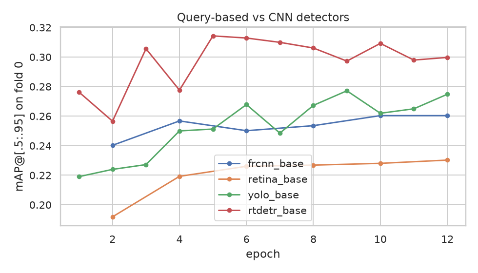

(The curves use each framework's own per-epoch validation on every 20th fold-0 frame, so they show trends, not exact values.)

**Loss modifications**

- *GIoU in the Faster R-CNN RoI head* replaces smooth-L1 with $1-\mathrm{GIoU}$. It raised small-object recall (0.353 to 0.374) but also produced more detections inside ignored regions and in background, and mAP did not change (0.2595 to 0.2608).
- *NWD in YOLO* uses the normalised Wasserstein distance, $\mathrm{NWD}=\exp\!\big(-W_2(\mathcal N_a,\mathcal N_b)/C\big)$ with $C=32$, to give a smoother signal for tiny boxes. mAP rose by 0.004 but AP_small fell (0.0797 to 0.0739), so it did not do what it was meant to do.
- *Hungarian matcher cost in RT-DETR* gave 0.3004 against 0.2971, which is smaller than the spread between two runs of the same configuration (0.3004 versus 0.2945).

**Reading the table**

1. The query-based detector is the clear winner: RT-DETR-l at 1344 px (about 0.295-0.300 over three runs) is 0.02-0.03 mAP above the best CNN detector (Faster R-CNN with tuned anchors, 0.2736) and 0.05 above YOLO11s, and its AP_small is higher (about 0.10 versus 0.08). Its speed (10-12 fps) is close to Faster R-CNN (11-14 fps) and far below YOLO (75 fps).
2. Matching the anchors to the data helped the two-stage model (+0.014, borderline given the noise below) but hurt RetinaNet badly (-0.045). We did not investigate why.
3. Resolution is the most useful single change for RT-DETR: 1344 px to 1536 px gave +0.01 to +0.015 on validation, which alone would be within noise, and +0.029 on the leaderboard (0.3137 to 0.3426). Going further to 1792 px did not help (§4). For YOLO, 1920 px gave +0.006, within noise.
4. RT-DETR-x (0.3135) is no better than RT-DETR-l (0.3096) at the same resolution, at about two thirds of the speed.

### How much to trust the numbers

Three YOLO runs with an identical configuration span 0.022 mAP: 0.2294 (seed 1), 0.2449 and 0.2514 (both seed 0; training on a GPU is not bit-exact, so the same seed does not give the same model). Two RT-DETR runs differ by 0.006, and two runs of the P2-head YOLO by 0.018 (§5.3). Since we have a single validation fold of about 12 clips, we treat differences below roughly 0.02 as inconclusive. Only the family ranking (RT-DETR above the rest) is clearly outside this noise on validation; the effect of the input resolution is supported mainly by the leaderboard.

**Full cross-validation of every model.** The task asks for cross-validation, so every configuration in this report was trained and evaluated on each of the five clip-level folds (same settings as on fold 0, one seed; the runs on folds 1-4 were done on Kaggle T4 GPUs, those of the extra variants on a teammate's account). Mean mAP over the five held-out folds, best first:

| Model (trained on 4 folds, tested on the fifth) | f0 | f1 | f2 | f3 | f4 | mean ± std |
|---|---|---|---|---|---|---|
| RT-DETR-l 1536 px (final configuration) | 0.3096 | 0.3148 | 0.2674 | 0.2652 | 0.2737 | **0.2861** ± 0.0241 |
| RT-DETR-l 1344, re-weighted matcher cost | 0.3004 | 0.3054 | 0.2523 | 0.2720 | 0.2724 | **0.2805** ± 0.0221 |
| RT-DETR-l 1344 px | 0.2971 | 0.3096 | 0.2627 | 0.2663 | 0.2651 | **0.2802** ± 0.0217 |
| Faster R-CNN (default anchors) | 0.2595 | 0.2696 | 0.2190 | 0.2071 | 0.2379 | **0.2386** ± 0.0263 |
| Faster R-CNN + GIoU box loss | 0.2608 | 0.2798 | 0.2130 | 0.2091 | 0.2298 | **0.2385** ± 0.0308 |
| Faster R-CNN, 16 px anchors | 0.2736 | 0.2700 | 0.2100 | 0.2062 | 0.2316 | **0.2383** ± 0.0321 |
| YOLO11s at 1920 px | 0.2511 | 0.2624 | 0.2092 | 0.2123 | 0.2340 | **0.2338** ± 0.0234 |
| YOLO11s + NWD loss | 0.2489 | 0.2442 | 0.2071 | 0.1987 | 0.2236 | **0.2245** ± 0.0221 |
| YOLO11s | 0.2449 | 0.2546 | 0.1977 | 0.2033 | 0.2165 | **0.2234** ± 0.0252 |
| YOLO11s P3/P4 head | 0.2308 | 0.2504 | 0.1979 | 0.2064 | 0.2195 | **0.2210** ± 0.0207 |
| YOLO11s + P2 head, head-weight transfer | 0.2446 | 0.2526 | 0.1813 | 0.2117 | 0.2138 | **0.2208** ± 0.0286 |
| YOLO11s P2 head without P5 | 0.2210 | 0.2577 | 0.1900 | 0.2074 | 0.2023 | **0.2157** ± 0.0260 |
| YOLO11s + P2 head | 0.2178 | 0.2561 | 0.1819 | 0.2095 | 0.1850 | **0.2101** ± 0.0300 |
| RetinaNet v2 | 0.2287 | 0.2412 | 0.1801 | 0.1886 | 0.1940 | **0.2065** ± 0.0268 |
| RetinaNet, 12 px anchors | 0.1834 | 0.1859 | 0.1476 | 0.1591 | 0.1511 | **0.1654** ± 0.0181 |

(`results/cv_*.csv`; the RT-DETR-l 1536 px row also gives AP50 0.5299 ± 0.0392, AP_small 0.1090 ± 0.0234 and AP_large 0.4585 ± 0.0496.)

What the cross-validation shows:

- **The family ranking holds on every fold.** RT-DETR-l is above Faster R-CNN, which is above YOLO11s, which is above RetinaNet, on all five folds without exception. The mean gap between RT-DETR (0.2802 at 1344 px) and Faster R-CNN (0.2386) is 0.04, and the smallest per-fold gap is 0.03.
- **The mAP differs by up to 0.05 between folds** (0.265 to 0.315 for RT-DETR 1536 px), more than twice the run-to-run noise above. Folds 0 and 1 are the two easiest for every model, so the fold-0 numbers in the rest of the report are optimistic by about 0.02.
- **Tuning that looked good on fold 0 did not carry over.** On fold 0 the 16 px anchors raised Faster R-CNN from 0.2595 to 0.2736 and NWD raised YOLO11s from 0.2449 to 0.2489; over the five folds the means are 0.2383 against 0.2386 and 0.2245 against 0.2234, i.e. no difference. The 12 px anchors for RetinaNet looked worse on fold 0 (0.1834 against 0.2287) and are worse on average (0.1654 against 0.2065). The re-weighted matcher cost of RT-DETR is 0.2805 against 0.2802. Only the larger input of YOLO11s (1920 px) is above its baseline on average (+0.010), which is inside the seed noise.
- **None of our custom YOLO heads helps** (§5.3): the four head variants are 0.2101 to 0.2210 against 0.2234 for the standard head.
- **Resolution for RT-DETR:** 1536 px is +0.006 over 1344 px on the mean, small compared with the fold-to-fold spread, so the leaderboard (0.3426 against 0.3137 for models trained on the same fold) remains the clearer evidence for it.

Because the folds differ so much, a difference between two models on one fold is informative only if it is large compared with the fold-to-fold spread. This is the main reason why the fold-0 ensemble result did not carry over to the leaderboard.

## 4. Final pipeline and what did not help

Best single model: RT-DETR-l at 1536 px, trained on all 63 clips, with inference at 1536 px and `conf=0.001`. Final submission: the ensemble described at the end of this section (`src/hw2/final_ensemble.py`).

| Submission | Description | Fold 0 mAP | Public LB |
|---|---|---|---|
| frcnn_base | Faster R-CNN baseline | 0.2595 | 0.2125 |
| rtdetr_base | RT-DETR-l 1344 | 0.2971 | 0.3137 |
| rtdetr_1536 | RT-DETR-l 1536 (fold-0 training only) | 0.3096 | 0.3426 |
| **rtdetr_all_1536** | RT-DETR-l 1536, all 63 clips | n/a (trained on the fold) | **0.3465** |
| + flip TTA | same model, horizontal-flip TTA | 0.3180 | 0.3458 |
| ensemble | RT-DETR (all) + TTA with Faster R-CNN (16-256 anchors), WBF 2:1, IoU 0.7 | 0.3322 | 0.3251 |
| low-res augmentation | all-clips model trained with random down-sampling | 0.2961 | 0.3245 |
| rescoring only | `rtdetr_all_1536` + Seq-NMS-style rescoring (§5.1) | n/a | 0.3505 |
| WBF of 2 RT-DETR | `rtdetr_all_1536` and `rtdetr_x_all` (all clips), 1:1, IoU 0.7 | n/a | 0.3484 |
| WBF of 7 RT-DETR | 2 all-clip models (weight 2) and 5 fold models (weight 1), IoU 0.7 | n/a | 0.3649 |
| WBF of 7 + rescoring | same + Seq-NMS-style rescoring | n/a | 0.3675 |
| **final: WBF of 10 + rescoring** | 2 big all-clip models and 8 all-clip RT-DETR-l 1536 models (different training frames and seeds), IoU 0.7, + rescoring | n/a | **0.3724** |

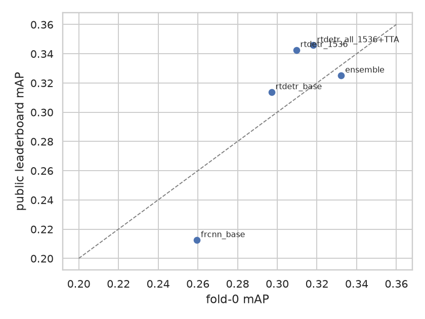

Inference variants on fold 0 (RT-DETR-l 1536):

| Strategy | mAP | AP_small | s/frame |
|---|---|---|---|
| full frame | 0.3095 | 0.1022 | 0.13 |
| + flip TTA | 0.3180 | 0.1037 | 0.23 |
| 2x2 tiles (SAHI-like) | 0.2865 | 0.0895 | 0.29 |
| 2x2 tiles + TTA | 0.2956 | 0.0921 | 0.39 |
| 3x3 tiles | 0.2712 | 0.0833 | 0.39 |

- **Tiling hurt.** Cutting the frame into tiles lowered mAP, including AP_small. The model already sees the frame at 1536 px, so tiles mostly add duplicated and truncated boxes.
- **More training frames hurt.** Training on 2.5 times more frames (every 4th instead of every 10th) lowered validation mAP (0.2911 against 0.3096 at 1536 px). Those frames are near-duplicates and the model saturates after one or two epochs, so the new frames mostly add overfitting to the training clips. The diversity is in the number of clips, not frames.
- **The Faster R-CNN ensemble disagrees between validation and leaderboard.** On fold 0 it is the best result (+0.014 over TTA alone, 0.3322), but on the leaderboard it is 0.021 *worse* than the single model. TTA alone gives +0.0085 on fold 0 and -0.0007 on the leaderboard. We do not have a verified explanation. One candidate is the distribution gap below; another is that a single fold of about 12 clips is simply a poor proxy for the 48 test clips.
- **A resolution gap exists, but we cannot prove it is the cause.** The test set contains low-resolution clips that the labelled data lacks (§1). Degrading fold 0 to 800 px lowers the base model from 0.3096 to 0.2776 (AP_small 0.1024 to 0.0713), so the gap is real. We tried to close it with low-resolution augmentation (30% of images at 640-1000 px). It helped on degraded input (0.2776 to 0.2784, AP_small 0.0713 to 0.0814) but cost 0.0135 on clean input, and on the leaderboard the augmented all-clips model scored 0.3245 against 0.3465. So augmentation was not the fix, and whether this gap explains the ensemble's drop remains a hypothesis.

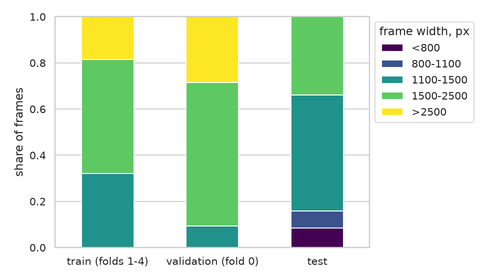

**An ensemble of RT-DETR models helped on the leaderboard.** Fusing only RT-DETR models (unlike the Faster R-CNN ensemble above) gave the best result: two all-clip models +0.002 (0.3484), and seven models, adding the five fold models trained on 80% of the clips each, +0.018 (0.3649) over the single model. Temporal rescoring then added +0.004 to the single model and +0.003 to the ensemble. These ensembles cannot be validated on a held-out fold, because every fold model saw four of the other five folds, and the all-clip models saw all of them, so **the leaderboard is the only measurement we have for them**. On fold 0 a four-model RT-DETR ensemble had given only +0.001 (0.3108 against 0.3096, `ensembles.csv`), so validation again did not predict the leaderboard, this time in our favour. A possible explanation is that models trained on different subsets of clips make different errors on unseen clips, which averaging removes. We did not test this. This also means the choice of final submissions for these ensembles cannot rest on an internal score, which the task asks for. We state this as a limitation.

**More members trained on all clips.** The ten-model ensemble replaces the five fold models by eight further RT-DETR-l 1536 models, each trained on all 63 clips but on a different set of frames (frame offsets 2, 4, 6, 8 of every 10) and with a different seed, and fuses them with `rtdetr_all_1536` and `rtdetr_x_all` before the same rescoring. It scores 0.3724, +0.005 over the seven-model version. We have no held-out measurement for it either, and the 0.0009 lead over the second place is too small to read as a real difference. `final_ensemble.py --set extra` rebuilds it.

**Longer training and higher resolution.** Two late fold-0 runs tested whether the final configuration was under-trained or under-resolved (notebook 07). Both start from the COCO checkpoint and use every 5th frame, like `rtdetr_s5_1536`.

| Run | Change from rtdetr_s5_1536 | mAP | AP50 | AP_small | fps |
|---|---|---|---|---|---|
| rtdetr_s5_1536 (reference) | 12 epochs, 1536 px, batch 3 | 0.3096 | 0.5510 | 0.1024 | 10.2 |
| rtdetr_e24 | 24 epochs | 0.2755 | 0.4925 | 0.0726 | 9.3 |
| rtdetr_1792 | 1792 px (batch 2, to fit in T4 memory) | 0.3035 | 0.5430 | 0.0990 | 7.1 |

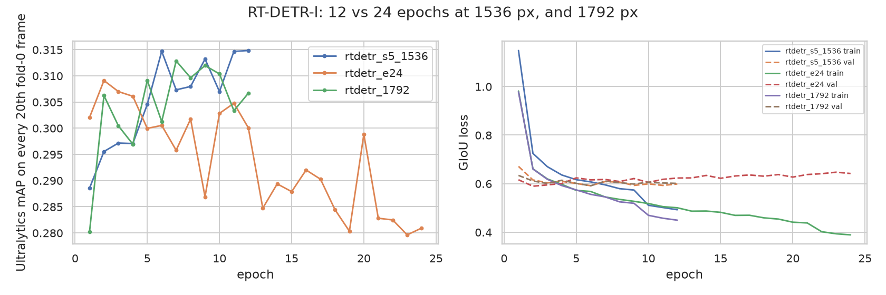

- **Twice as many epochs overfit.** The training GIoU loss keeps falling (0.50 at epoch 12, 0.39 at epoch 24) while the validation GIoU loss rises (0.62 to 0.64). The per-epoch mAP of the 24-epoch run peaks at epoch 2 (0.309, Ultralytics' own validation) and ends at 0.28, 0.034 below the 12-epoch model, which is beyond our noise level. This agrees with the "more frames" result above: the training set holds only about 50 distinct clips, and the model memorises them. The longer run also stretches the learning-rate decay over 24 epochs, so it is not exactly "the 12-epoch model trained further".
- **1792 px gave nothing measurable.** 0.3035 against 0.3096 is within noise, at 70% of the speed. The batch size had to drop from 3 to 2, so resolution is not the only change. We did not submit either model, since neither beat the reference on fold 0.

## 5. Bonus tasks

### 5.1 Temporal information

We implemented Seq-NMS-style rescoring (Han et al., 2016) without the suppression step. Same-class detections in consecutive frames are linked when their IoU exceeds a threshold, and dynamic programming finds the highest-scoring path through each detection backwards and forwards in time. The score becomes $s'=(1-\beta)\,s+\beta\,\bar s_{\text{path}}$. We also tried T-CNN-style propagation, which copies confident neighbour detections into the current frame with a decayed score. Both run as post-processing on the RT-DETR predictions for consecutive frames of the fold-0 clips (RT-DETR-l 1536, score ≥ 0.01).

| Method | mAP | AP50 | AP_small |
|---|---|---|---|
| no temporal step | 0.3095 | 0.5511 | 0.1022 |
| first attempt: averaging scores over a window of ±1/±2/±4 frames (best: ±2, α=0.3) | 0.3090 | 0.5490 | 0.1028 |
| Seq-rescore, mean path, β=0.5, IoU 0.5 | 0.3141 | 0.5597 | 0.0974 |
| Seq-rescore, mean path, β=0.3, IoU 0.5 | 0.3152 | 0.5617 | 0.1013 |
| Seq-rescore, max path, β=0.5, IoU 0.5 | 0.3110 | 0.5509 | 0.1000 |
| **Seq-rescore, mean path, β=0.5, IoU 0.7** | **0.3176** | 0.5635 | 0.0988 |
| Propagation (conf 0.6, decay 0.5) | 0.3097 | 0.5524 | 0.1023 |
| Propagation (conf 0.8, decay 0.9) | 0.3088 | 0.5496 | 0.1022 |

The naive window average gives nothing and rescoring along linked paths gives about +0.008 mAP, with the gain in AP50 (+0.012) larger than in AP_small, which falls slightly. Propagation gives nothing because the recall (AR500) does not increase. **Caveats:** the settings were chosen on the same fold they are evaluated on, and the gain is about half of the run-to-run noise from §2, so it is weak evidence at best. On the leaderboard it raised the single all-clip model from 0.3465 to 0.3505 and the seven-model ensemble from 0.3649 to 0.3675, so we kept it in the final submission. The leaderboard gain is small and the public score is computed on part of the test set only, so we do not claim more than a consistent small positive effect.

### 5.2 Visualisation and Weights & Biases

Notebook 06 looks inside both detector types on fold-0 frames. Code is in `src/hw2/viz.py`. Training curves, losses, configurations and final metrics of every run are logged to Weights & Biases by `src/hw2/wandb_log.py`: [wandb.ai/pasichnyk-pn-ukrainian-catholic-university/hw2-visdrone-vid](https://wandb.ai/pasichnyk-pn-ukrainian-catholic-university/hw2-visdrone-vid). The runs were trained on Kaggle without W&B access and uploaded afterwards, so wall-clock times in W&B are upload times. Validation images with predicted and ground-truth boxes are attached to the four runs of §4 and §5.3 whose prediction files we kept (`rtdetr_e24`, `rtdetr_1792`, `yolo_base_r2`, `yolo_p2_hinit_r2`).

**Grad-CAM for YOLO11s.** The target is the class score of the prediction that best covers a ground-truth box. Maps are taken at three backbone stages and three neck outputs.

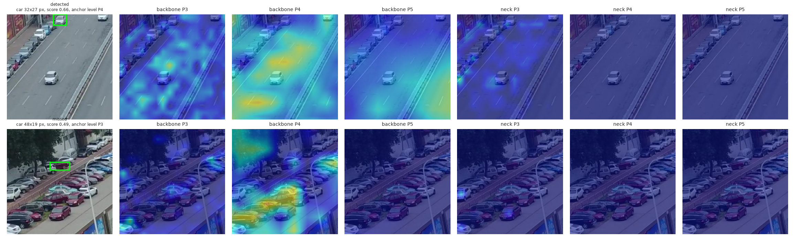
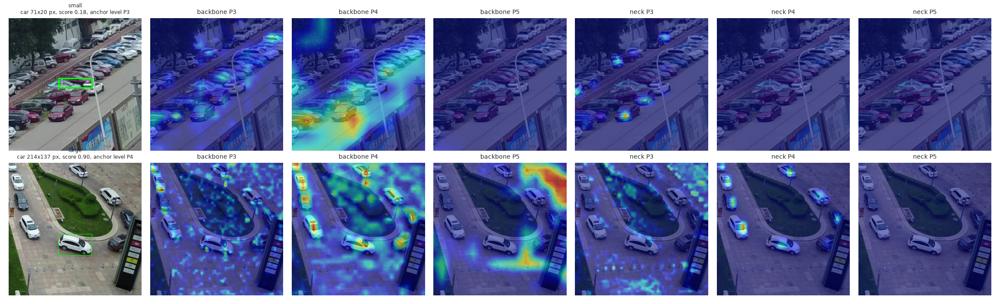

Over 90 ground-truth objects (30 per size bin) the prediction chosen for an object comes from a level that matches its size:

| Object size | stride 8 (P3) | stride 16 (P4) | stride 32 (P5) |
|---|---|---|---|
| small (<32 px) | 77% | 20% | 3% |
| medium | 80% | 20% | 0% |
| large (>96 px) | 0% | 87% | 13% |

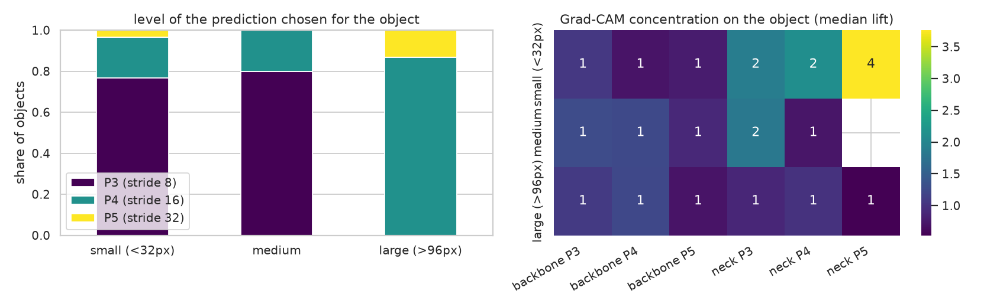

However, the maps themselves are **not sharply focused on the object**. We measured the share of the heat-map mass inside the box (dilated by 16 px) divided by the share of the image the window covers, where 1 means no better than uniform. The median is between 0.7 and 1.3 for the backbone layers and between 0.5 and 2.1 for the neck layers, except 3.8 for small objects at the stride-32 neck output. So Grad-CAM at these layers shows which scale is used, but only weakly shows where the evidence is. In the first figure above the neck P4 and P5 maps are almost empty. We did not investigate why and did not try other CAM variants.

**RT-DETR deformable attention.** We keep the sampling locations and weights of all six decoder layers for 60 random validation frames (4,098 queries with score ≥ 0.5).

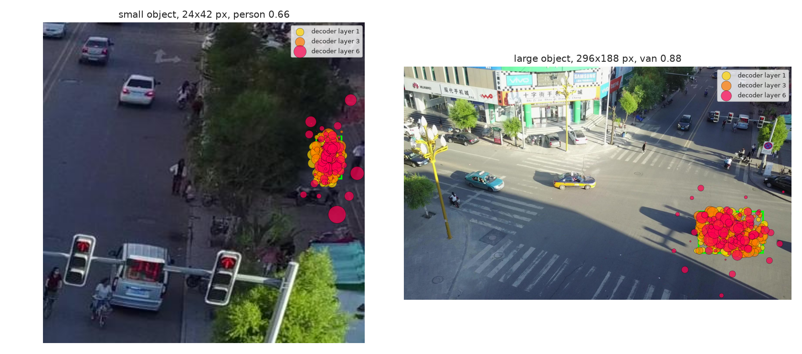
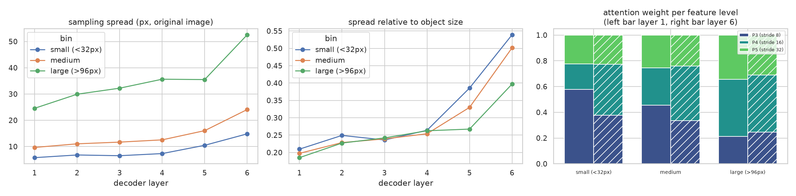

- The sampling points get **more spread out with depth**, not less. Measured relative to the object size, the median spread of small objects grows from 0.21 in layer 1 to 0.54 in layer 6 (large objects: 0.19 to 0.40). In the first four layers queries sample tightly inside the object (about a quarter of its size), and in the last two layers they take wider context.
- Small objects rely on the finest feature map: the share of attention weight on the stride-8 level for small objects rises from 0.58 (layer 1) to 0.65 (layers 3-4) and then falls to 0.38 in layer 6, where weight moves to the coarser levels. For large objects the stride-8 share is only 0.21 to 0.38. This agrees with the YOLO result above.

**Query embeddings.** We project the 256-d last-layer embedding of 5,937 queries (score ≥ 0.3) with t-SNE.

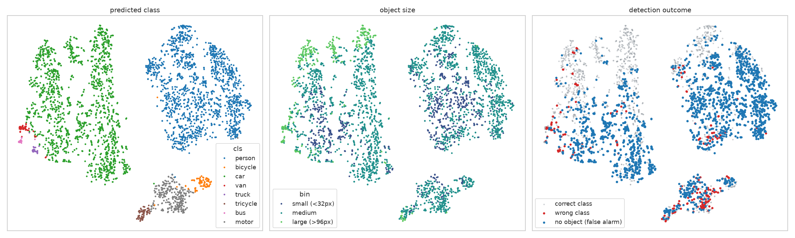

A $k$-nearest-neighbour check (k = 10) in the original space finds that the majority class of the neighbours equals the predicted class for 99.5% of queries. This is expected, since the embedding feeds the class head directly, so it shows that the embedding is consistent with the output rather than that it is a good representation. Per class the agreement is lowest for van (0.87), truck (0.92) and bus (0.92), the three rarest vehicle classes.

### 5.3 Custom architectures (negative result)

Small objects are the bottleneck, so we modified the YOLO11s detection head. `P2` adds a stride-4 level, `P2-noP5` also removes the stride-32 level, and `P3P4` keeps only strides 8 and 16. Because the new head layers have no pretrained weights, `P2-hinit` copies the weights of the matching levels of the pretrained head (297 of 593 tensors transfer).

| Run | mAP | AP50 | AP_small | AP_large | fps |
|---|---|---|---|---|---|
| yolo_base (reference) | 0.2449 | 0.4427 | 0.0797 | 0.4004 | 74.9 |
| yolo_base_s1 (other seed) | 0.2294 | 0.4123 | 0.0769 | 0.3859 | 71.3 |
| yolo_base_r2 (repeat of reference) | 0.2514 | 0.4551 | 0.0787 | 0.4220 | 74.7 |
| P2 head, new weights | 0.2178 | 0.4301 | 0.0756 | 0.3524 | 50.9 |
| P2 head, transferred head weights | 0.2446 | 0.4656 | 0.0797 | 0.3893 | 54.1 |
| P2 head, transferred head weights, repeat | 0.2269 | 0.4308 | 0.0796 | 0.3818 | 54.6 |
| P2, no P5 | 0.2210 | 0.4359 | 0.0763 | 0.3551 | 56.9 |
| P3 + P4 only | 0.2308 | 0.4274 | 0.0733 | 0.3802 | 74.5 |

None of the variants beats the reference. We repeated the reference and the best variant (`P2-hinit`) once more, and the five runs overlap completely: three reference runs span 0.2294-0.2514 and two `P2-hinit` runs 0.2269-0.2446. Every variant lies inside or below the reference range, never above it.

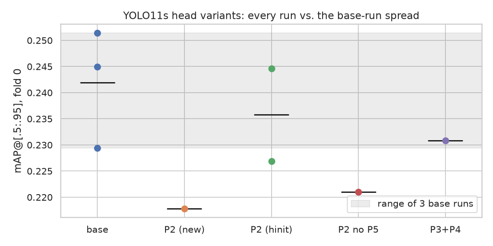

The P2 head was meant to find more small objects, and it does not. AP_small is 0.0796-0.0797 for both `P2-hinit` runs and 0.0787-0.0797 for the references. With the predictions of the two repeated runs (notebook 07) we also checked recall directly. Small-object recall is the same at every score threshold (0.329 against 0.328 at score ≥ 0.3, 0.465 against 0.477 at ≥ 0.05). On 150 random validation frames the P2 head misses fewer small objects than the reference in 25 frames and more in 29 (933 against 939 misses in total). The failure frames picked automatically for the reference are the same ones as in §3, and the P2 head fails on them in the same way: distant parked cars in `uav0000124_00944` remain undetected.

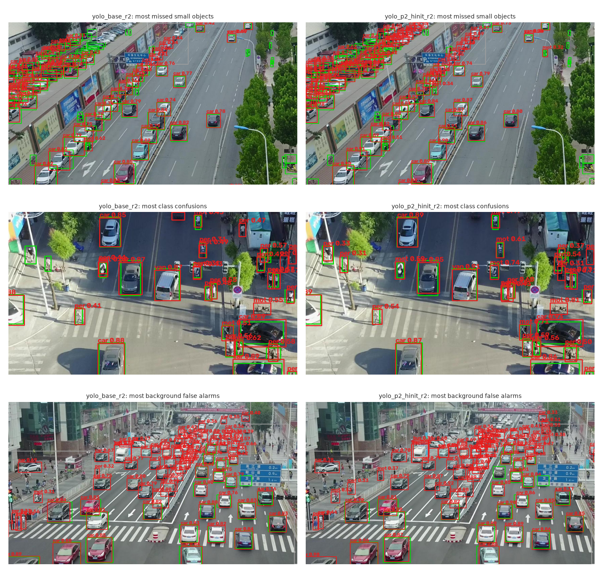

Transferring the head weights recovers the loss from random initialisation (0.2178 to 0.2446 and 0.2269) but does not go beyond the pretrained model. The P2 head costs about 30% of the speed. Our conclusion is limited to 12 epochs and at most two runs per variant. Given the RT-DETR result in §4, we do not expect longer training to change it on this amount of data, but we did not test that for YOLO.

## 6. Conclusions

- A query-based detector (RT-DETR) at high input resolution was the best choice for this dataset. The advantage over CNN detectors (+0.04 mean mAP over the best CNN detector, Faster R-CNN, on five folds) and the benefit of 1536 px over 1344 px (clear on the leaderboard) are the only effects above the noise of our protocol. Going further, to 1792 px or to 24 epochs, did not help, and 24 epochs overfit.
- Most of our other ideas (tiling, more frames, loss changes, extra detection levels, an ensemble with Faster R-CNN, low-resolution augmentation) gave nothing or hurt on the leaderboard. What did help was an ensemble of RT-DETR models trained on different sets of clips or frames (+0.018 for seven models, +0.023 for ten) and temporal rescoring (+0.003 to +0.004). A lesson from this is that **a single validation fold is a weak guide**: the Faster R-CNN ensemble had the best fold-0 score of any inference variant and was our worst use of a submission, while the RT-DETR ensemble showed almost nothing on fold 0 and was the largest leaderboard gain.
- The final result is 0.3724 mAP on the public leaderboard (0.3465 for the best single model).

**Limitations.** Every configuration was cross-validated, but with one seed per fold (the seed noise of about 0.02 is as large as most differences between variants), a hidden test set that differs from the labelled data in resolution, and gains from the ensemble and the temporal step that are measured only on the public leaderboard. All numbers are COCO mAP computed with our own evaluator on fold 0, except the leaderboard column.

**Reproducing.** Code is in `src/hw2/` (data preparation `prep.py`, training `tv_train.py` and `ultra_train.py`, inference `infer.py`, post-processing `postprocess.py`, evaluation `evaluate.py`). Training ran on Kaggle T4 GPUs through the scripts in `kernels/`. All metrics are in `results/` and the analysis notebooks are in `notebooks/`.
